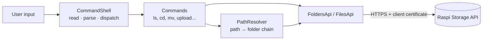

# rs: Raspi Storage CLI

**An interactive terminal shell for [Raspi Storage](https://github.com/miinii14/raspi-storage), my self-hosted file storage running on a Raspberry Pi 5.**


`rs` lets you browse and manage files on the server the way you would in a regular shell: `cd` into folders, `ls`, `tree`, move and rename things, upload and download files with a progress bar. It talks to the server's REST API over mutual TLS, so the only "login" is a client certificate.

The backend only exposes a REST API, so using it meant `curl` with three certificate flags and copying folder GUIDs between requests. I needed a real client for it, but I didn't want to build a website, because frontend work is not what I enjoy. A terminal shell was the natural fit: paths instead of IDs, and commands everyone already knows.

---

## Features

- **Shell-like navigation**: `cd`, `ls`, `tree` with relative and absolute paths, `.` and `..`
- **File management**: `mkdir`, `rename`, `mv`, `rm` (recursive folder delete asks for confirmation)
- **Transfers**: `upload` / `download` with a live progress bar, streamed without loading the file into memory
- **Safe downloads**: data goes to a `.part` file first and replaces the target only when the transfer completes
- **Clear errors**: every server error is RFC 7807 `problem+json`, shown as `✗ 409 Conflict: File named 'holiday.mp4' already exists in this location`
- **Ctrl+C cancels the running command**, not the shell
- **Mutual TLS** with a private CA, no passwords or tokens

---

## Commands

| Command | Description |
|---|---|
| `ls [path]` | List files and folders |
| `cd <path>` | Change current folder |
| `tree [path]` | Show folder structure recursively, with sizes and totals |
| `mkdir <path>` | Create folder |
| `rename <path> <new-name>` | Rename file or folder |
| `mv <path> <target-dir>` | Move file or folder to another folder |
| `rm <path>` | Remove file or folder |
| `upload <local-file> [remote-dir]` | Upload local file to current or given folder |
| `download <remote-file> [local]` | Download file to current or given local path |
| `clear` | Clear console output |
| `help` | Show available commands |
| `exit` | Exit the shell |

Local paths support `~` for the home directory. Names with spaces are not supported.

---

## How it works



1. **CommandShell** reads a line (PrettyPrompt with history), splits it into tokens and looks the command up in a dictionary.
2. Each **command** implements one small `ICommand` interface and gets the API clients through its constructor.
3. The server only knows folder IDs, not paths. **PathResolver** turns a path like `../Photos/2024` into a chain of folders by walking the tree level by level.
4. **FoldersApi / FilesApi** are thin typed wrappers around `HttpClient`. A shared base class turns any non-success response into an `ApiException`.
5. One `try/catch` in the shell loop prints every error in the same format. Commands just throw.

---

## Design decisions

**An interactive shell, not one-shot subcommands.**
A git-style `rs ls /photos` would be simpler to build, but every call would start from scratch: no current folder, and a new mutual TLS handshake each time. A long-running shell keeps both. You `cd` once and work with short relative paths, and one `HttpClient` reuses the same connection for the whole session.

**Paths are resolved on the client.**
The API identifies everything by GUID and only knows "children of folder X". Instead of adding path lookup to the server, the CLI resolves `a/b/c` one segment at a time, asking for the children of the previous folder at each step. The current location is stored as a chain of folders, not as a path string, so `..` just drops the last element and needs no request, and the prompt is built from the chain.

**One error format end to end.**
The server used to return errors in three shapes: a JSON string, ASP.NET validation `problem+json`, and plain text for auth failures. Parsing all three on the client felt like a workaround, so I changed the backend and the nginx error pages to return RFC 7807 `problem+json` with a machine-readable `code` everywhere. The client now has one code path: any non-success response becomes an `ApiException`, and the shell maps known codes (`cert_invalid`, `quota_exceeded`, …) to friendly messages. Validation rules live only on the server, so the CLI never disagrees with it.

**Cancellation per command.**
Ctrl+C should stop a long upload, not kill the shell. Every command gets its own `CancellationTokenSource`, and the `CancelKeyPress` handler cancels only the current one. A single token shared by the whole session would not work: once cancelled, it stays cancelled, and every later command would fail immediately.

**Progress without buffering.**
Uploads and downloads must work for files bigger than RAM. `ProgressStream` is a decorator around any `Stream`: it passes data through and reports how many bytes went by, so the progress bar works with plain streaming and no copy in memory. Downloads are written to `<name>.part` and moved over the target only after the last byte arrives, so a failed or cancelled download never leaves a half-written file behind.

**Keeping the current location valid.**
Because the location is a chain of folders, some operations could break it. Removing or moving the folder you are in, or one of its parents, is rejected before any request is sent. Renaming a parent updates the chain, so the prompt shows the new name right away.

---

## Tests

64 unit tests, run with `dotnet test`. No network or server needed.

- Pure logic: path parsing, local path resolution, size formatting (culture-independent), `ProgressStream`.
- API layer and commands run against an **in-memory fake server**. `HttpClient` gets a custom `HttpMessageHandler`, so the real API classes, JSON handling and error mapping are exercised; only the network is replaced.

The tests found two real bugs: size formatting depended on the system locale, and synchronous stream reads did not report progress.

---

## Getting started

### Prerequisites

- .NET 10 SDK
- A running [Raspi Storage](https://github.com/miinii14/raspi-storage) server
- A client certificate signed by the server's CA (see the [server README](https://github.com/miinii14/raspi-storage#2-certificates))

### Configuration

Create `~/.config/raspi-storage/config.json`:

```json
{
  "serverUrl": "https://<server-address>/",
  "clientCert": "/path/to/client.crt",
  "clientKey": "/path/to/client.key",
  "caCert": "/path/to/ca.crt"
}
```

The server certificate is trusted only if it is signed by `caCert`. The system trust store is not used.

### Run

```bash
dotnet run --project src/RaspiStorage.Cli
```

### Build a single binary

```bash
dotnet publish src/RaspiStorage.Cli -c Release -r linux-x64 \
  --self-contained -p:PublishSingleFile=true -o publish
./publish/rs
```

---

## Tech stack

| Area | Technology |
|---|---|
| Language | C# / .NET 10 |
| Terminal UI | [Spectre.Console](https://spectreconsole.net/) (tables, tree, progress, prompts) |
| Line editing | [PrettyPrompt](https://github.com/waf/PrettyPrompt) (history, cursor movement) |
| HTTP | `HttpClient` + `SocketsHttpHandler` with mutual TLS and custom root trust |
| Tests | xUnit |

---

## Project structure

```
src/RaspiStorage.Cli/
├── Program.cs           Entry point: config → HttpClient → shell
├── Config/              config.json loading, mTLS HttpClient setup
├── Api/                 ApiBase, FoldersApi, FilesApi
├── DTOs/                Request/response records
├── Exceptions/          ApiException, CliException, ConfigException
└── Shell/
    ├── CommandShell.cs  Read–dispatch loop, error output, Ctrl+C
    ├── Context.cs       Current folder chain
    ├── ProgressStream.cs
    └── Commands/        One class per command + PathResolver
tests/RaspiStorage.Cli.Tests/
└── Fakes/               Fake HttpMessageHandler and in-memory server
```

---

## License

[MIT](LICENSE)
